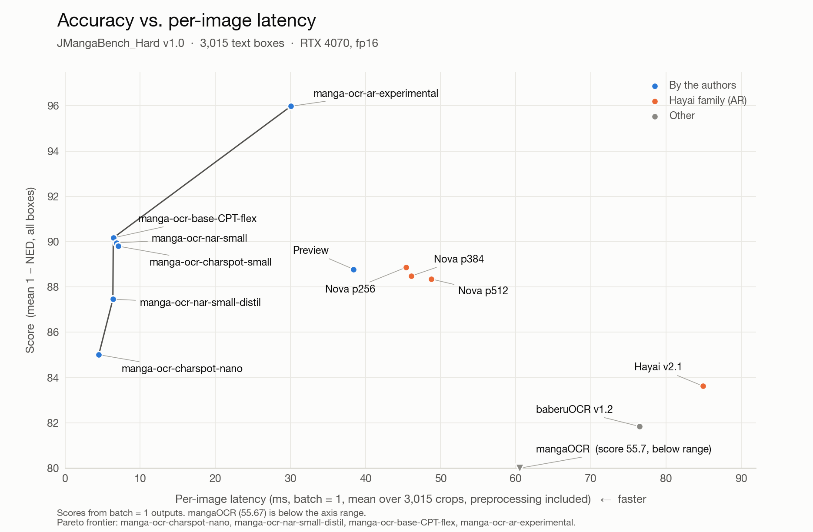
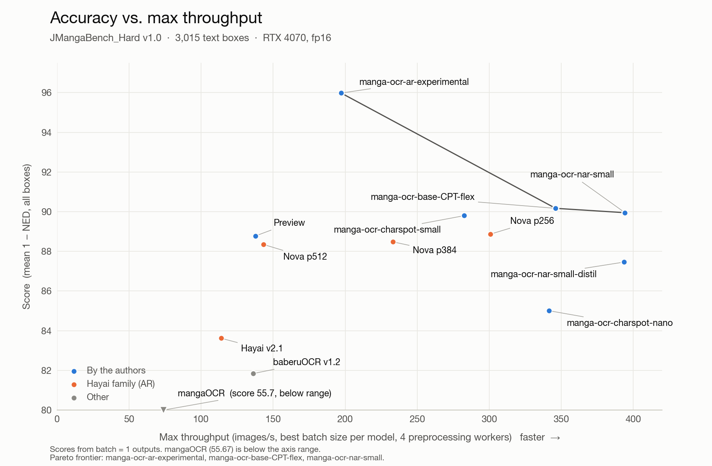

# JMangaBench_Hard v1.0 — a hard-text Japanese manga OCR benchmark

[English](README.md) | [中文](README_zh.md) · [Interactive leaderboard](https://muscgab.github.io/JMangaBench_Hard/) · Dataset (images): [Hugging Face](https://huggingface.co/datasets/muscgab/JMangaBench_Hard) · [ModelScope](https://www.modelscope.cn/datasets/muscgab/JMangaBench_Hard)

JMangaBench_Hard evaluates OCR models on the text that [JMangaBench_Read](https://github.com/muscgab/JMangaBench_Read) leaves out or rarely contains: sound effects drawn into the artwork, stylised and decorative lettering, titles, and handwriting. It is a companion to Read and uses the same page pool, normalization and model setups.

- 3,015 text boxes from 1,339 pages by 1,339 artists (one page per artist).
- All pages first posted between 2025-10-01 and 2026-10-01.
- Labels from three LLM readers with image tools and human review (854 boxes human-decided).
- A box is kept only if it has one accepted reading; boxes that two or more readings explain equally well are removed.
- Accuracy and speed measured on one RTX 4070.

> **Note.** Every box here is a hard case. The scores show how models behave at the extreme end, not how well they read manga in everyday use. Most text on a typical page is ordinary dialogue and narration; for that, see [JMangaBench_Read](https://github.com/muscgab/JMangaBench_Read).

Found an error in a label, a score or the docs? Please [open an issue](https://github.com/muscgab/JMangaBench_Hard/issues). Corrections are welcome.

## Leaderboard

Ranked by score (mean 1 − normalized edit distance, defined in [Scoring](#scoring)). 3,015 boxes, RTX 4070.

| # | Model | Arch | Params | Score ↑ | CER % ↓ | EM % ↑ | EM NFKC % ↑ | Per-image ms ↓ | Max img/s ↑ |
|---|---|---|---|---|---|---|---|---|---|
| 1 | manga-ocr-ar-experimental † ‡ | AR | 131M | **95.98** | 4.75 | 88.52 | 88.26 | 30.1 | 197 (b20) |
| 2 | PaddleOCR-VL-1.6 manga LoRA v6 ※ | AR (VLM) | 959M | **91.87** | 9.21 | 78.57 | 69.55 | — | — |
| 3 | manga-ocr-base-CPT-flex † ¶ | AR | 111M | **90.17** | 11.16 | 74.73 | 74.43 | 6.4 | 346 (b24) |
| 4 | manga-ocr-nar-small † | NAR | 54M | **89.95** | 11.15 | 73.03 | 72.77 | 6.9 | 394 (b10) |
| 5 | manga-ocr-charspot-small † ◇ | CharDet | 11M | **89.80** | 11.50 | 73.90 | 73.37 | 7.1 | 283 (b256) |
| 6 | Hayai v2.5 Nova p256 | AR | 157M | **88.87** | 11.61 | 72.34 | 71.87 | 45.4 | 301 (b40) |
| 7 | Preview † | NAR | 196M | **88.78** | 12.72 | 71.04 | 69.62 | 38.4 | 138 (b16) |
| 8 | Hayai v2.5 Nova p384 | AR | 157M | **88.48** | 11.96 | 72.31 | 71.91 | 46.1 | 233 (b48) |
| 9 | Hayai v2.5 Nova p512 | AR | 157M | **88.35** | 12.11 | 71.71 | 71.31 | 48.8 | 143 (b16) |
| 10 | manga-ocr-nar-small-distil † ∥ | NAR | 30M | **87.46** | 14.16 | 68.99 | 68.72 | 6.4 | 393 (b10) |
| 11 | manga-ocr-charspot-nano † ◇ | CharDet | 1.7M | **85.01** | 17.78 | 65.07 | 64.54 | 4.5 | 341 (b128) |
| 12 | Hayai v2.1 | AR | 156M | **83.62** | 17.09 | 62.59 | 60.36 | 85.0 | 114 (b128) |
| 13 | baberuOCR v1.2 | AR | 113M | **81.84** | 20.67 | 63.42 | 60.90 | 76.5 | 136 (b192) |
| 14 | mangaOCR | AR | 111M | **55.67** | 48.33 | 31.24 | 29.68 | 60.5 | 74 (b64) |
| – | GPT-6.1 Sol * | LLM | — | 97.47 | 2.47 | 93.60 | 93.27 | — | — |
| – | Claude Opus 5.5 * | LLM | — | 94.38 | 5.61 | 86.00 | 85.41 | — | — |
| – | GPT-6.1 Terra * | LLM | — | 92.81 | 6.89 | 84.58 | 83.65 | — | — |

<details><summary>More models</summary>

| # | Model | Arch | Params | Score ↑ | CER % ↓ | EM % ↑ | EM NFKC % ↑ | Per-image ms ↓ | Max img/s ↑ |
|---|---|---|---|---|---|---|---|---|---|
| – | nar-small-R16 † △ | NAR | 54M | **93.92** | 7.21 | 82.89 | 82.62 | 6.9 | 349 (b16) |

</details>

- † Made by the authors of this benchmark (see [Conflict of interest](#conflict-of-interest)).
- ‡ manga-ocr-ar-experimental: an experimental release by the authors (ViT-B encoder, 2-layer autoregressive decoder). fp16 and fp32 outputs agree on 3,014 of 3,015 boxes.
- ¶ manga-ocr-base-CPT-flex: mangaOCR after continued pre-training by the authors; see the Read leaderboard notes.
- ∥ manga-ocr-nar-small-distil: at its max-throughput batch size its outputs match batch-size-1 outputs on 96.7% of the 512 timed crops; for every other model the match is 99.8–100%.
- ◇ Character detection with a learned reading order and no text decoder.
- △ nar-small-R16: an experimental model by the authors (branch `r16` of [muscgab/manga-ocr-nar-small](https://huggingface.co/muscgab/manga-ocr-nar-small/tree/r16)), listed without a rank.
- ※ PaddleOCR-VL-1.6 manga LoRA v6: [sorryhyun/paddleocr-vl-1.6-manga-lora](https://huggingface.co/sorryhyun/paddleocr-vl-1.6-manga-lora/tree/57e7c65024d753022299340b3b9b6aafc158a79b/v6), folder `v6` (commit 57e7c650), a fine-tune of [PaddlePaddle/PaddleOCR-VL-1.6](https://huggingface.co/PaddlePaddle/PaddleOCR-VL-1.6); its training data include Manga109-s and COO. Accuracy only (added 2026-11-10): run on an Ascend 910B NPU in bf16 with the loading and generation code of its model card (batches of 16, greedy, at most 80 new tokens; no output reaches the limit). Speed was not measured, so the speed columns are empty and the model is not in the charts. Crops are used as given, as for every model (its card suggests a 12% margin).
- \* LLM readers. The agreed reading of all three defines 2,161 of the labels, and their readings were shown during human review, so these rows are listed for reference and are not ranked. On the 854 human-decided boxes: GPT-6.1 Sol 91.08 / EM 77.40, Claude Opus 5.5 80.16 / EM 50.59, GPT-6.1 Terra 74.62 / EM 45.55.
- PaddleOCR-VL-For-Manga (on the Read leaderboard) was not measured for this version.
- Accuracy columns use batch-size-1 outputs (PaddleOCR-VL-1.6 manga LoRA v6: batches of 16, see ※). EM NFKC: exact match after Unicode NFKC only, for reference. `bN`: batch size at maximum throughput.

### EM by subset

| Model | agreed (2,161) | human (854) | sfx lettering (1,835) | handwritten (1,056) | box adjusted (75) |
|---|---|---|---|---|---|
| manga-ocr-ar-experimental | 94.26 | 74.00 | 89.26 | 88.07 | 70.67 |
| PaddleOCR-VL-1.6 manga LoRA v6 | 86.58 | 58.31 | 79.89 | 76.70 | 50.67 |
| manga-ocr-base-CPT-flex | 83.20 | 53.28 | 73.02 | 78.12 | 60.00 |
| manga-ocr-nar-small | 82.05 | 50.23 | 71.06 | 76.80 | 52.00 |
| manga-ocr-charspot-small | 82.14 | 53.04 | 72.32 | 77.56 | 48.00 |
| Hayai v2.5 Nova p256 | 81.30 | 49.65 | 69.37 | 77.08 | 48.00 |
| Preview | 80.10 | 48.13 | 69.43 | 74.43 | 50.67 |
| Hayai v2.5 Nova p384 | 81.58 | 48.83 | 68.99 | 77.37 | 49.33 |
| Hayai v2.5 Nova p512 | 81.44 | 47.07 | 68.77 | 75.95 | 42.67 |
| manga-ocr-nar-small-distil | 78.39 | 45.20 | 66.70 | 73.86 | 41.33 |
| manga-ocr-charspot-nano | 74.32 | 41.69 | 61.53 | 71.78 | 42.67 |
| Hayai v2.1 | 72.24 | 38.17 | 58.58 | 67.99 | 40.00 |
| baberuOCR v1.2 | 72.98 | 39.23 | 61.85 | 65.62 | 45.33 |
| mangaOCR | 38.45 | 13.00 | 23.00 | 43.37 | 17.33 |
| nar-small-R16 | 90.10 | 64.64 | 83.11 | 83.43 | 60.00 |

### Accuracy vs. speed

Click a chart to open the interactive version (subsets: all / agreed / human-decided / sfx lettering / handwritten / box adjusted; nar-small-R16 under "More models").

[](https://muscgab.github.io/JMangaBench_Hard/)

[](https://muscgab.github.io/JMangaBench_Hard/)

## Data

### Source

Same page pool as JMangaBench_Read: black-and-white Japanese comic pages posted publicly online by independent artists, collected for research use. Source type and license follow [AnimeText](https://huggingface.co/datasets/deepghs/AnimeText).

| Rule | Value |
|---|---|
| Posting date | 2025-10-01 to 2026-10-01 |
| Artists | one page per artist, 1,339 artists |
| Color | black-and-white |
| Content rating | general 1,863 boxes, sensitive 376, questionable 131, explicit 645 |
| Language | Japanese |
| Excluded artists | those who publicly prohibit reposting or AI use |

The content rating is that of the source page. Some source pages contain adult content; the crops are tight text boxes, and the reviewer removed sensitive crops among the boxes seen in review.

### Relation to JMangaBench_Read

- No box is shared with Read v1.3.3 (main set or SFX set); boxes already in either set were removed from the candidates.
- 905 pages also have boxes in the Read main set (361 of them Read v1.2 pages, 544 v1.3 pages), and 176 pages have boxes in the Read SFX set. Different boxes on the same page are in different sets.

### Overlap with AnimeText

The lowest page ID in this benchmark is 10,055,261. The [AnimeText](https://huggingface.co/datasets/deepghs/AnimeText) image IDs range up to 8,475,567 and the [animetext-ocr](https://huggingface.co/datasets/JustANormalTinkerer/animetext-ocr) source image IDs up to 8,475,560, so no page is shared (dataset revisions of 2026-10-04).

### Box selection

**1. Detection.** The Read candidate pool: AnimeText YOLO12x detector, confidence ≥ 0.425, the smaller box kept for nested boxes; general pages keep all boxes, other pages up to 8 random boxes.

**2. Candidates.** Boxes of the pool that GPT-6.1 Sol had screened (Read step 2) and that are not in Read v1.3.3 or its SFX set. Kept: boxes Sol admitted or sent to review with usable quality. Removed: text cut off by the box, no text, prohibition notices, signatures, watermarks, promotion and non-Japanese text.

**3. Categories** (Sol's role and font labels; boxes in the final set):

| Category | Boxes |
|---|---|
| Sound effects, titles and artistic lettering | 2,386 |
| Very large sound effects and titles (excluded from Read as large decorative text) | 188 |
| Artistic or handwritten scene text (logos, signs, screens) | 114 |
| Handwritten dialogue | 261 |
| Other handwritten text (notes, narration, signs) | 66 |

### Labeling

**Readers.** Three LLMs read every candidate box independently, with the same instructions, the same output schema and the same four image tools: zoom into a region, rotate, enhance (contrast, invert, binarize, sharpen) and view the page around the box (only to judge box boundaries). Reasoning effort high. Besides the text, each reader reported alternative readings, whether the box is ambiguous (and why), whether it is unreadable, whether the crop is a usable single text box, the visual style and the orientation.

| Reader | Boxes read |
|---|---|
| GPT-6.1 Terra | 3,542 |
| GPT-6.1 Sol | 3,542 |
| Claude Opus 5.5 | 3,542 (3,115 through the API, 427 by Claude Code with the same instructions and tools) |

**Transcription rules** (given to the readers and applied in review):

- The characters inside the box in reading order; no spaces or line breaks; no correction from story context.
- Small and large kana, repeated characters, long-vowel marks and punctuation exactly as drawn.
- Symbols inside a text line are transcribed whatever their size (`♡`, `☆`, `♪`, `!?`, arrows). Floating decorations outside the text line are not. A box that contains only decorations is removed.
- Furigana are not transcribed. A voicing mark on a kana without a voiced form is written as the base character followed by `゛` (32 labels).
- `○` for circles, `〇` only as the kanji numeral zero.

**One accepted reading.** A box is removed when two or more different strings explain the image equally well, for example a vowel exclamation whose small or large kana cannot be told apart. Disagreement between readers alone is not a reason to remove a box; such boxes are decided by a human.

**Decision rules.**

| Case | Result | Boxes |
|---|---|---|
| Two or more readers flag the box as ambiguous or unreadable, majority reason "kana size" | removed | 125 |
| Two or more readers judge the crop unusable | removed | 87 |
| Three readings identical after normalization, no flag by Terra or Sol | agreed reading (Sol's spelling) | 2,161 |
| All other boxes | human review | 1,169 |
| — kept by the reviewer | human-decided label | 854 |
| — removed by the reviewer (no single accepted reading) | removed | 315 |

Of the 2,161 agreed boxes, 276 carry a flag by Opus alone.

**Human review.** One reviewer decided every box in the review queue in six sections:

| Section | Kept / reviewed |
|---|---|
| Three readings agree, some reader flagged the box | 78 / 99 |
| Two readings agree, some reader flagged the box | 304 / 412 |
| Three different readings, some reader flagged the box | 150 / 271 |
| Three different readings, no flag | 26 / 32 |
| Symbol rule check (whether a symbol is in the text line) | 63 / 80 |
| Two readings agree, no flag | 233 / 275 |

The interface showed the crop, the page around it and the three readings (plus Sol's earlier screening reading), never an OCR model's output. When two readings agreed, that reading was pre-filled. The reviewer could choose a reading, enter a new one, adjust the box or remove the box. Of the 854 kept labels, 99 equal all three readings, 498 two, 189 one and 68 none.

**Adjusted boxes.** In 75 kept boxes the detector box cut off part of the text or included unrelated text; the reviewer redrew the box and the crop was cut again from the page. `gt.jsonl` keeps both the final box (`xyxy`) and the detector box (`xyxy_yolo`).

**Repeated text.** Identical text drawn more than once on the same page is kept as separate boxes: 236 groups, 532 boxes.

### Subsets

| Subset | Definition | Boxes |
|---|---|---|
| all | all boxes | 3,015 |
| agreed | three identical readings, label not checked per box | 2,161 |
| human | human-decided label | 854 |
| box adjusted | box redrawn in review | 75 |
| sfx lettering | majority visual style of the three readers | 1,835 |
| handwritten | 〃 | 1,056 |
| decorative font | 〃 | 73 |
| printed | 〃 | 51 |
| vertical / horizontal / curved or diagonal | majority orientation | 1,842 / 670 / 501 (2 mixed) |

Labels are short: median 3 characters, 572 boxes with 5 or more, longest 32.

### Development use

- No image from the page pool or the benchmark was used to train the authors' models. Whether the same pages also appear in other public manga collections used for training has not been checked.
- 19 boxes were in the authors' "Sol handwriting" development set (see the Read README), and 499 pages share other boxes with it.
- Aggregate statistics of the page pool informed the design of the authors' synthetic training data (see the Read README).
- During construction, the authors ran their models and others on a 2,693-box snapshot (2026-11-01) to check the labels. No model was trained, selected or tuned on it.

## Scoring

Predictions and labels are normalized with **RIN v1.2**, the same rules as Read v1.3.3 ([Read: Scoring](https://github.com/muscgab/JMangaBench_Read#scoring)). Labels store the raw text (`text`) and the normalized text (`text_rin`).

**Metrics**

- Score (ranking metric): mean over all boxes of 1 − normalized edit distance (ICDAR 2019 ReCTS), × 100. Unlike Read, there is no printed / non-printed split: 98% of the boxes are not printed.

$$s_i = 1 - \frac{\mathrm{ED}(p_i, g_i)}{\max(|p_i|, |g_i|)}, \qquad \text{Score} = \frac{100}{N}\sum_i s_i$$

- CER: total edit distance / total label characters.
- EM: fraction of boxes with an exact match.

## Speed

One RTX 4070 (12 GB), all models in fp16 unless stated in [Models](#models), as in Read. The host gives the run 11 cores of a Xeon E5-2650 v4, with library threads capped at 8. Images are pre-decoded in memory. Timings include the model's preprocessing and decoding and are GPU-synchronized.

| Measure | Method |
|---|---|
| Per-image latency | batch size 1, single process; mean over all 3,015 crops after 20 warm-up crops |
| Max throughput | 512 crops; preprocessing in 4 worker processes in parallel with the GPU (main process: 3 threads); batch size searched up to the memory limit; median of 3 runs at the best batch size |

There is no per-page column: the benchmark keeps only 2.25 boxes per page on average, so a page batch here does not reflect a real page. Speeds are not comparable with the Read leaderboard, which was timed on an RTX 2080 Ti.

## Models

| Model | Weights | Settings |
|---|---|---|
| manga-ocr-ar-experimental † | [muscgab/manga-ocr-ar-experimental](https://huggingface.co/muscgab/manga-ocr-ar-experimental), tag `ema106k` | fp16; the inference code released with the model (CUDA graph for the decoder step) |
| manga-ocr-base-CPT-flex † | [muscgab/manga-ocr-base-CPT-flex](https://huggingface.co/muscgab/manga-ocr-base-CPT-flex) | encoder fp16, decoder fp32; the CUDA path of the released package |
| manga-ocr-nar-small † | [muscgab/manga-ocr-nar-small](https://huggingface.co/muscgab/manga-ocr-nar-small) | fp16; the CUDA backend released with the model |
| manga-ocr-nar-small-distil † | [muscgab/manga-ocr-nar-small-distil](https://huggingface.co/muscgab/manga-ocr-nar-small-distil) | fp16 with simulated int8; the CUDA backend released with the model |
| manga-ocr-charspot-small † | [muscgab/manga-ocr-charspot-small](https://huggingface.co/muscgab/manga-ocr-charspot-small) | fp32; the CUDA backend released with the model |
| manga-ocr-charspot-nano † | [muscgab/manga-ocr-charspot-nano](https://huggingface.co/muscgab/manga-ocr-charspot-nano) | dense network fp16; the CUDA backend released with the model |
| nar-small-R16 † | [muscgab/manga-ocr-nar-small, branch `r16`](https://huggingface.co/muscgab/manga-ocr-nar-small/tree/r16) | fp16; the CUDA backend on that branch |
| Preview † | [muscgab/manga-ocr-nar-preview](https://huggingface.co/muscgab/manga-ocr-nar-preview) | fp16 |
| Hayai v2.1 | [JustANormalTinkerer/hayai-ocr-v2](https://huggingface.co/JustANormalTinkerer/hayai-ocr-v2) (main branch = v2.1) | 256 patches; greedy; fp16 |
| Hayai v2.5 Nova | [JustANormalTinkerer/hayai-ocr-v2.5-nova](https://huggingface.co/JustANormalTinkerer/hayai-ocr-v2.5-nova) | 256 / 384 / 512 patches; otherwise as above |
| baberuOCR v1.2 | [genshiai-daichi/baberu-ocr](https://huggingface.co/genshiai-daichi/baberu-ocr), tag `v1.2` | fp16; README generation settings, except at most 128 new tokens |
| PaddleOCR-VL-1.6 manga LoRA v6 ※ | [sorryhyun/paddleocr-vl-1.6-manga-lora](https://huggingface.co/sorryhyun/paddleocr-vl-1.6-manga-lora/tree/57e7c65024d753022299340b3b9b6aafc158a79b/v6), folder `v6`, commit `57e7c650` | bf16 on an Ascend 910B (not timed); the model card's code: PEFT merge of the LoRA, then `lm.safetensors`; prompt `OCR:`; greedy; at most 80 new tokens; batches of 16 sorted by crop area, left padding |
| mangaOCR | [kha-white/manga-ocr-base](https://huggingface.co/kha-white/manga-ocr-base) | fp16; package defaults otherwise |

## Conflict of interest

manga-ocr-ar-experimental, manga-ocr-nar-small, nar-small-R16, manga-ocr-nar-small-distil, manga-ocr-charspot-small, manga-ocr-charspot-nano, manga-ocr-base-CPT-flex and Preview are made by the authors of this benchmark.

- Labels come from three third-party LLMs and human review. The review interface showed LLM readings only, no OCR model outputs.
- Box selection and labels do not use any OCR model output.
- All model predictions, the scoring script and the speed scripts are released.

## Limitations

- The 2,161 agreed labels are not checked per box, and no random audit of them has been done.
- One person reviewed all 1,169 boxes. When two readings agreed, that reading was pre-filled.
- The removal rule ("one accepted reading") was applied by LLM flags and by one reviewer; another reviewer may draw the line elsewhere, especially for small kana and repeated marks.
- The LLM readings were shown in review, so the LLM rows are biased upward even on the human-decided boxes.
- The candidates come from GPT-6.1 Sol's screening; boxes it judged unreadable or damaged are not included.
- All boxes were cropped by one detector (AnimeText YOLO12x), except 75 boxes redrawn by hand.
- Labels are short (median 3 characters), so EM moves in large steps per box and a few characters decide a score.
- One source type (recent fan and original works), one GPU type.

## Usage

```bash
pip install regex
python eval/score.py --pred my_preds.jsonl --name my_model --out results/my_model.json
```

`my_preds.jsonl`: one line per box, `{"key": "10055261_6", "pred": "グイッ"}`. Missing keys count as empty predictions.

| Location | Content |
|---|---|
| `data/gt.jsonl` | labels and metadata, 3,015 boxes |
| `data/llm_readings.jsonl` | three LLM readings per box |
| `data/predictions/` | outputs of all listed models (batch size 1; PaddleOCR-VL-1.6 manga LoRA v6: batches of 16) |
| `eval/` | scoring script and RIN normalization code |
| `speed/` | speed scripts |
| `results/` | raw speed results per model (per-image run and max-throughput search) |
| `figures/`, `docs/` | chart scripts, static charts and the interactive leaderboard |
| [Hugging Face](https://huggingface.co/datasets/muscgab/JMangaBench_Hard) / [ModelScope](https://www.modelscope.cn/datasets/muscgab/JMangaBench_Hard) | crop images at original resolution: `crops/<key>.png`, with `crops/metadata.jsonl` |

`gt.jsonl` fields: `key`, `file`, `text`, `text_rin`, `n_chars`, `review` (`consensus` / `human`), `box_edited`, `xyxy`, `xyxy_yolo`, `crop_wh`, `page_id`, `box`, `rating`, `visual_style`, `orientation`, `sol_role`, `sol_font`, `review_sec`.

For evaluation only. Do not use for training.

## Corrections

If you find any error (a wrong label, a box that should not be in the set, a scoring or speed problem), please [open an issue](https://github.com/muscgab/JMangaBench_Hard/issues). Fixes go into the next version.

## License

[CC BY-NC-SA 4.0](https://creativecommons.org/licenses/by-nc-sa/4.0/) for data and code.

## Citation

```bibtex
@misc{jmangabench_hard,
  title  = {JMangaBench\_Hard: Sound Effects, Stylised Lettering and Handwriting in Japanese Manga OCR},
  year   = {2026},
  url    = {https://github.com/muscgab/JMangaBench_Hard}
}
```
