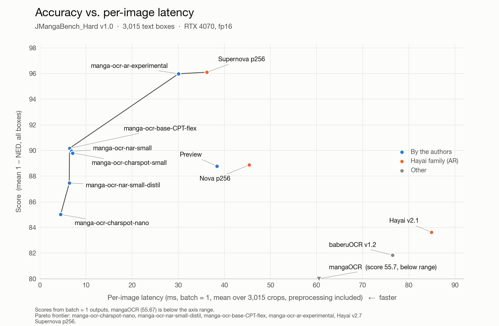
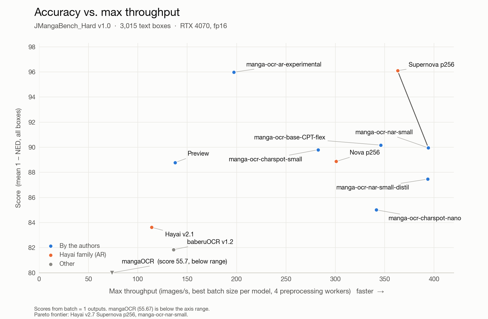

# JMangaBench_Hard v1.0：日文漫画难文字 OCR 评测集

[English](README.md) | [中文](README_zh.md) · [交互式榜单](https://muscgab.github.io/JMangaBench_Hard/) · 数据集（图片）：[Hugging Face](https://huggingface.co/datasets/muscgab/JMangaBench_Hard) · [ModelScope](https://www.modelscope.cn/datasets/muscgab/JMangaBench_Hard)

JMangaBench_Hard 评测 OCR 模型在 [JMangaBench_Read](https://github.com/muscgab/JMangaBench_Read) 不收录或很少出现的文字上的表现：画进画面里的拟声词、风格化与装饰字体、标题和手写字。它是 Read 的姊妹集，页面池、归一化规则和参评模型设置都与 Read 相同。

- 3,015 个文字框，来自 1,339 页、1,339 位画师（每位画师一页）。
- 全部页面首次发布于 2025-10-01 至 2026-10-01。
- 标签来自三个带图像工具的 LLM 识别器和人工审核，其中 854 框由人工裁定。
- 只收有唯一公认读法的框；两种及以上读法都能同样解释图像的框一律删除。
- 在一张 RTX 4070 上测准确率和速度。

> **说明：** 本集只收难例。分数反映的是模型在极端情况下的表现，不代表日常读漫画时的真实水平。一般页面上的文字以普通对白和旁白为主，这部分请看 [JMangaBench_Read](https://github.com/muscgab/JMangaBench_Read)。

发现标签、分数或文档有错误，欢迎[提 issue](https://github.com/muscgab/JMangaBench_Hard/issues) 联系我们。

## 排行榜

按得分排名（1 − 归一化编辑距离的平均值，定义见[评分](#评分)）。3,015 框，RTX 4070。

| # | 模型 | 架构 | 参数量 | 得分 ↑ | CER % ↓ | EM % ↑ | EM NFKC % ↑ | 逐张 ms ↓ | 最大吞吐 img/s ↑ |
|---|---|---|---|---|---|---|---|---|---|
| 1 | Hayai v2.7 Supernova p256 | AR | 158M | **96.10** | 4.76 | 88.76 | 88.49 | 36.2 | 363 (b32) |
| 2 | manga-ocr-ar-experimental † ‡ | AR | 131M | **95.98** | 4.75 | 88.52 | 88.26 | 30.1 | 197 (b20) |
| 3 | PaddleOCR-VL-1.6 manga LoRA v6 ※ | AR (VLM) | 959M | **91.87** | 9.21 | 78.57 | 69.55 | — | — |
| 4 | manga-ocr-base-CPT-flex † ¶ | AR | 111M | **90.17** | 11.16 | 74.73 | 74.43 | 6.4 | 346 (b24) |
| 5 | manga-ocr-nar-small † | NAR | 54M | **89.95** | 11.15 | 73.03 | 72.77 | 6.9 | 394 (b10) |
| 6 | manga-ocr-charspot-small † ◇ | CharDet | 11M | **89.80** | 11.50 | 73.90 | 73.37 | 7.1 | 283 (b256) |
| 7 | Hayai v2.5 Nova p256 | AR | 157M | **88.87** | 11.61 | 72.34 | 71.87 | 45.4 | 301 (b40) |
| 8 | Preview † | NAR | 196M | **88.78** | 12.72 | 71.04 | 69.62 | 38.4 | 138 (b16) |
| 9 | manga-ocr-nar-small-distil † ∥ | NAR | 30M | **87.46** | 14.16 | 68.99 | 68.72 | 6.4 | 393 (b10) |
| 10 | manga-ocr-charspot-nano † ◇ | CharDet | 1.7M | **85.01** | 17.78 | 65.07 | 64.54 | 4.5 | 341 (b128) |
| 11 | Hayai v2.1 | AR | 156M | **83.62** | 17.09 | 62.59 | 60.36 | 85.0 | 114 (b128) |
| 12 | baberuOCR v1.2 | AR | 113M | **81.84** | 20.67 | 63.42 | 60.90 | 76.5 | 136 (b192) |
| 13 | mangaOCR | AR | 111M | **55.67** | 48.33 | 31.24 | 29.68 | 60.5 | 74 (b64) |
| – | GPT-6.1 Sol * | LLM | — | 97.47 | 2.47 | 93.60 | 93.27 | — | — |
| – | Claude Opus 5.5 * | LLM | — | 94.38 | 5.61 | 86.00 | 85.41 | — | — |
| – | GPT-6.1 Terra * | LLM | — | 92.81 | 6.89 | 84.58 | 83.65 | — | — |

<details><summary>更多模型</summary>

| # | 模型 | 架构 | 参数量 | 得分 ↑ | CER % ↓ | EM % ↑ | EM NFKC % ↑ | 逐张 ms ↓ | 最大吞吐 img/s ↑ |
|---|---|---|---|---|---|---|---|---|---|
| – | ns3-98k † | AR | 131M | **96.73** | 3.71 | 90.48 | 90.22 | 9.5 | 300 (b12) |
| – | nar-small-R16 † △ | NAR | 54M | **93.92** | 7.21 | 82.89 | 82.62 | 6.9 | 349 (b16) |
| – | Hayai v2.5 Nova p384 | AR | 157M | **88.48** | 11.96 | 72.31 | 71.91 | 46.1 | 233 (b48) |
| – | Hayai v2.5 Nova p512 | AR | 157M | **88.35** | 12.11 | 71.71 | 71.31 | 48.8 | 143 (b16) |

**分板块完全匹配率**

| 模型 | 三家一致 (2,161) | 人工裁定 (854) | 拟声字 (1,835) | 手写 (1,056) | 调整过框 (75) |
|---|---|---|---|---|---|
| ns3-98k | 94.77 | 79.63 | 90.95 | 90.15 | 73.33 |
| nar-small-R16 | 90.10 | 64.64 | 83.11 | 83.43 | 60.00 |
| Hayai v2.5 Nova p384 | 81.58 | 48.83 | 68.99 | 77.37 | 49.33 |
| Hayai v2.5 Nova p512 | 81.44 | 47.07 | 68.77 | 75.95 | 42.67 |

</details>

- † 本评测集作者的模型（见[利益关联声明](#利益关联声明)）。
- 本评测作者发布的实验模型 ns3-98k 按 Hard 选点，列在“更多模型”中，在 RTX 4070 上用同一 FP16 后端测逐张和最大吞吐。
- ‡ manga-ocr-ar-experimental：作者的实验性发布（ViT-B 编码器 + 2 层自回归解码器）。fp16 与 fp32 输出在 3,015 框中有 3,014 框相同。
- ¶ manga-ocr-base-CPT-flex：作者在 mangaOCR 基础上继续预训练的模型，详见 Read 榜单注释。
- ∥ manga-ocr-nar-small-distil：在最大吞吐的 batch 下，512 张计时裁图中 96.7% 的输出与 batch 1 相同；其他模型都在 99.8–100%。
- ◇ 字符检测加学习到的阅读顺序，没有文本解码器。
- △ nar-small-R16：作者的实验模型（[muscgab/manga-ocr-nar-small](https://huggingface.co/muscgab/manga-ocr-nar-small/tree/r16) 的 `r16` 分支），列出但不排名。
- ※ PaddleOCR-VL-1.6 manga LoRA v6：[sorryhyun/paddleocr-vl-1.6-manga-lora](https://huggingface.co/sorryhyun/paddleocr-vl-1.6-manga-lora/tree/57e7c65024d753022299340b3b9b6aafc158a79b/v6) 的 `v6` 目录（commit 57e7c650），在 [PaddlePaddle/PaddleOCR-VL-1.6](https://huggingface.co/PaddlePaddle/PaddleOCR-VL-1.6) 上微调；训练数据包括 Manga109-s 与 COO。只测准确率（2026-11-10 加入）：在 Ascend 910B NPU 上以 bf16 运行，加载与生成用其模型卡的代码（每批 16 框、贪心解码、最多 80 个新 token；没有输出达到上限）。未测速度，因此速度各列为空，图中也没有它。裁图与其他模型一样原样输入（其模型卡建议留 12% 边距）。
- \* LLM 识别器。三家一致的读法直接构成 2,161 个标签，人工审核时也展示了它们的读法，所以这几行只作参考、不排名。在 854 个人工裁定框上：GPT-6.1 Sol 得分 91.08 / EM 77.40，Claude Opus 5.5 80.16 / EM 50.59，GPT-6.1 Terra 74.62 / EM 45.55。
- PaddleOCR-VL-For-Manga（在 Read 榜单上）本版本未测。
- 准确率各列用 batch 1 的输出（PaddleOCR-VL-1.6 manga LoRA v6 为每批 16 框，见 ※）。EM NFKC：只做 Unicode NFKC 后的全匹配率，供参考。`bN`：最大吞吐时的 batch 大小。

### 各板块 EM

| 模型 | 三家一致 (2,161) | 人工裁定 (854) | 拟声字 (1,835) | 手写 (1,056) | 调整过框 (75) |
|---|---|---|---|---|---|
| Hayai v2.7 Supernova p256 | 94.12 | 75.18 | 89.75 | 87.88 | 69.33 |
| manga-ocr-ar-experimental | 94.26 | 74.00 | 89.26 | 88.07 | 70.67 |
| PaddleOCR-VL-1.6 manga LoRA v6 | 86.58 | 58.31 | 79.89 | 76.70 | 50.67 |
| manga-ocr-base-CPT-flex | 83.20 | 53.28 | 73.02 | 78.12 | 60.00 |
| manga-ocr-nar-small | 82.05 | 50.23 | 71.06 | 76.80 | 52.00 |
| manga-ocr-charspot-small | 82.14 | 53.04 | 72.32 | 77.56 | 48.00 |
| Hayai v2.5 Nova p256 | 81.30 | 49.65 | 69.37 | 77.08 | 48.00 |
| Preview | 80.10 | 48.13 | 69.43 | 74.43 | 50.67 |
| manga-ocr-nar-small-distil | 78.39 | 45.20 | 66.70 | 73.86 | 41.33 |
| manga-ocr-charspot-nano | 74.32 | 41.69 | 61.53 | 71.78 | 42.67 |
| Hayai v2.1 | 72.24 | 38.17 | 58.58 | 67.99 | 40.00 |
| baberuOCR v1.2 | 72.98 | 39.23 | 61.85 | 65.62 | 45.33 |
| mangaOCR | 38.45 | 13.00 | 23.00 | 43.37 | 17.33 |

### 准确率与速度

点击图表打开交互版（板块：全部 / 三家一致 / 人工裁定 / 拟声字 / 手写 / 调整过框）。勾选“更多模型”可查看实验模型和其他配置。

[](https://muscgab.github.io/JMangaBench_Hard/)

[](https://muscgab.github.io/JMangaBench_Hard/)

## 数据

### 来源

与 JMangaBench_Read 同一个页面池：独立画师在网上公开发布的黑白日文漫画页，为研究用途收集。来源类型与许可证沿用 [AnimeText](https://huggingface.co/datasets/deepghs/AnimeText)。

| 规则 | 取值 |
|---|---|
| 发布时间 | 2025-10-01 至 2026-10-01 |
| 画师 | 每位画师一页，共 1,339 位 |
| 颜色 | 黑白 |
| 内容分级 | general 1,863 框、sensitive 376、questionable 131、explicit 645 |
| 语言 | 日文 |
| 排除的画师 | 公开声明禁止转载或禁止 AI 使用的画师 |

内容分级是原页面的分级。部分原页面含成人内容；裁图只是紧贴文字的框，审核者在审核过的框中剔除了敏感裁图。

### 与 JMangaBench_Read 的关系

- 与 Read v1.3.3（主集和 SFX 集）没有共用的框；已在这两个集合里的框在选候选时就去掉了。
- 905 页在 Read 主集里也有框（其中 361 页属于 Read v1.2，544 页属于 v1.3），176 页在 Read SFX 集里有框。同一页上的不同框分属不同集合。

### 与 AnimeText 的重合

本评测集页面 ID 最小为 10,055,261。[AnimeText](https://huggingface.co/datasets/deepghs/AnimeText) 的图片 ID 最大为 8,475,567，[animetext-ocr](https://huggingface.co/datasets/JustANormalTinkerer/animetext-ocr) 的来源图片 ID 最大为 8,475,560，没有共用页面（数据集版本 2026-10-04）。

### 选框

**1. 检测。** 沿用 Read 的候选池：AnimeText YOLO12x 检测器，置信度 ≥ 0.425，嵌套框保留较小的一个；general 页保留全部框，其他页最多随机保留 8 个框。

**2. 候选。** 候选池中经 GPT-6.1 Sol 初筛（Read 第 2 步）、且不在 Read v1.3.3 及其 SFX 集里的框。保留 Sol 收录或送审且画质可用的框；去掉文字被框截断、没有文字、禁止转载声明、签名、水印、宣传和非日文的框。

**3. 类别**（按 Sol 的角色和字体标签；数字为最终集中的框数）：

| 类别 | 框数 |
|---|---|
| 拟声词、标题和艺术字 | 2,386 |
| 特大拟声词和大标题（Read 作为大型装饰文字排除） | 188 |
| 艺术字或手写的场景文字（标志、招牌、屏幕） | 114 |
| 手写台词 | 261 |
| 其他手写文字（旁注、旁白、标牌） | 66 |

### 标注

**识别器。** 三个 LLM 各自独立读每一个候选框，使用相同的提示词、相同的输出格式和相同的四个图像工具：放大局部、旋转、增强（对比度、反色、二值化、锐化）、查看框周围的页面（只用于判断框的边界）。推理强度 high。除文字外，每家还给出备选读法、是否有歧义（及原因）、是否读不出、裁图是否为可用的单个文字框、视觉风格和方向。

| 识别器 | 读过的框 |
|---|---|
| GPT-6.1 Terra | 3,542 |
| GPT-6.1 Sol | 3,542 |
| Claude Opus 5.5 | 3,542（3,115 框经 API，427 框由 Claude Code 用相同提示词和工具完成） |

**转写规则**（给识别器的规则，审核时同样执行）：

- 按阅读顺序写框内的字；不加空格和换行；不按剧情语境改字。
- 大小假名、重复字符、长音符和标点按画面原样写。
- 文字行里的符号不论大小都转写（`♡`、`☆`、`♪`、`!?`、箭头）；漂浮在文字行外的装饰不转写；只有装饰的框删除。
- 不转写注音假名。没有浊音形式的假名加浊点时，写作原字加 `゛`（32 个标签）。
- 圆圈写 `○`，`〇` 只用于汉字数字零。

**唯一公认读法。** 两个及以上不同的字符串都能同样解释图像时删除该框，例如分不清大小假名的元音感叹词。识别器之间读法不一致本身不是删除理由，这类框交给人工裁定。

**判定规则。**

| 情况 | 结果 | 框数 |
|---|---|---|
| 两家及以上标为有歧义或读不出，多数原因为"假名大小" | 删除 | 125 |
| 两家及以上判定裁图不可用 | 删除 | 87 |
| 三家读法归一化后完全一致，Terra 和 Sol 都没有标记 | 采用一致读法（Sol 的写法） | 2,161 |
| 其余所有框 | 人工审核 | 1,169 |
| — 审核后保留 | 人工裁定的标签 | 854 |
| — 审核后删除（没有唯一公认读法） | 删除 | 315 |

2,161 个一致框中有 276 个只有 Opus 一家标记。

**人工审核。** 审核队列中的每一框都由同一位审核者裁定，分六段：

| 段 | 保留 / 审核 |
|---|---|
| 三家读法一致，有识别器标记 | 78 / 99 |
| 两家一致，有识别器标记 | 304 / 412 |
| 三家读法都不同，有识别器标记 | 150 / 271 |
| 三家读法都不同，没有标记 | 26 / 32 |
| 符号规则复核（符号是否在文字行里） | 63 / 80 |
| 两家一致，没有标记 | 233 / 275 |

审核界面展示裁图、框周围的页面和三家读法（另附 Sol 早先初筛时的读法），从不展示 OCR 模型的输出。两家读法一致时预填该读法。审核者可以选一个读法、输入新读法、调整框或删除该框。854 个保留标签中，与三家读法都相同的 99 个，与两家相同的 498 个，与一家相同的 189 个，与三家都不同的 68 个。

**调整过的框。** 75 个保留框的检测框截掉了部分文字或框进了无关文字，审核者重画了框，并从整页按新框重新裁图。`gt.jsonl` 同时保留最终框（`xyxy`）和检测框（`xyxy_yolo`）。

**重复文字。** 同一页上画了多次的相同文字作为不同的框分别保留：236 组，532 框。

### 板块

| 板块 | 定义 | 框数 |
|---|---|---|
| all | 全部框 | 3,015 |
| agreed | 三家读法一致，标签未逐框核对 | 2,161 |
| human | 人工裁定的标签 | 854 |
| box adjusted | 审核时重画了框 | 75 |
| sfx lettering | 三家视觉风格的多数票 | 1,835 |
| handwritten | 同上 | 1,056 |
| decorative font | 同上 | 73 |
| printed | 同上 | 51 |
| vertical / horizontal / curved or diagonal | 方向的多数票 | 1,842 / 670 / 501（另有 2 框 mixed） |

标签都很短：中位数 3 字，5 字及以上的 572 框，最长 32 字。

### 开发用途说明

- 页面池和本评测集的图片都没有用于训练作者的模型。这些页面是否也出现在训练用的其他公开漫画合集中，未做检查。
- 19 个框曾在作者的"Sol 手写"开发集中（见 Read 的 README），另有 499 页与该开发集共页（框不同）。
- 页面池的汇总统计用于设计作者的合成训练数据（见 Read 的 README）。
- 构建过程中，作者在一份 2,693 框的快照（2026-11-01）上跑过自己的模型和其他模型，用于检查标签。没有在这份快照上训练、选择或调整任何模型。

## 评分

预测和标签都用 **RIN v1.2** 归一化，规则与 Read v1.3.3 相同（[Read：评分](https://github.com/muscgab/JMangaBench_Read/blob/main/README_zh.md#评分)）。标签同时保存原文（`text`）和归一化后的文字（`text_rin`）。

**指标**

- 得分（排名指标）：所有框上 1 − 归一化编辑距离的平均值（ICDAR 2019 ReCTS），乘以 100。与 Read 不同，这里不分印刷体和非印刷体，因为 98% 的框都不是印刷体。

$$s_i = 1 - \frac{\mathrm{ED}(p_i, g_i)}{\max(|p_i|, |g_i|)}, \qquad \text{得分} = \frac{100}{N}\sum_i s_i$$

- CER：编辑距离总和 / 标签总字数。
- EM：完全匹配的框所占比例。

## 测速

一张 RTX 4070（12 GB），除[参评模型](#参评模型)中注明的以外全部用 fp16，与 Read 一致。主机给测速进程 11 个 Xeon E5-2650 v4 核心，库线程数上限 8。图片预先解码到内存。计时包含模型自己的预处理和解码，并做 GPU 同步。

| 指标 | 方法 |
|---|---|
| 逐张延迟 | batch 1，单进程；20 张预热后，对全部 3,015 张裁图取平均 |
| 最大吞吐 | 512 张裁图；预处理在 4 个工作进程中与 GPU 并行（主进程 3 线程）；batch 大小搜索到显存上限；在最佳 batch 上跑 3 次取中位数 |

不设整页延迟列：本评测集每页平均只收 2.25 个框，按页组 batch 不能代表真实的一页。速度不能和 Read 榜单比较，Read 在 RTX 2080 Ti 上测速。

## 参评模型

| 模型 | 权重 | 设置 |
|---|---|---|
| manga-ocr-ar-experimental † | [muscgab/manga-ocr-ar-experimental](https://huggingface.co/muscgab/manga-ocr-ar-experimental)，标签 `ema106k` | fp16；随模型发布的推理代码（解码步用 CUDA graph） |
| ns3-98k † | [ns3-98k](https://huggingface.co/muscgab/manga-ocr-ar-experimental/tree/ns3-98k) | FP16，编码与解码 CUDA Graph |
| Hayai v2.7 Supernova p256 | [Supernova](https://huggingface.co/JustANormalTinkerer/hayai-ocr-v2.7-supernova/tree/517bdeeb64b68c08939e12f7211e99943c1e1640) | 256 patch，FP16 CUDA Graph |
| manga-ocr-base-CPT-flex † | [muscgab/manga-ocr-base-CPT-flex](https://huggingface.co/muscgab/manga-ocr-base-CPT-flex) | 编码器 fp16，解码器 fp32；发布包的 CUDA 路径 |
| manga-ocr-nar-small † | [muscgab/manga-ocr-nar-small](https://huggingface.co/muscgab/manga-ocr-nar-small) | fp16；随模型发布的 CUDA 后端 |
| manga-ocr-nar-small-distil † | [muscgab/manga-ocr-nar-small-distil](https://huggingface.co/muscgab/manga-ocr-nar-small-distil) | fp16 模拟 int8；随模型发布的 CUDA 后端 |
| manga-ocr-charspot-small † | [muscgab/manga-ocr-charspot-small](https://huggingface.co/muscgab/manga-ocr-charspot-small) | fp32；随模型发布的 CUDA 后端 |
| manga-ocr-charspot-nano † | [muscgab/manga-ocr-charspot-nano](https://huggingface.co/muscgab/manga-ocr-charspot-nano) | 稠密网络 fp16；随模型发布的 CUDA 后端 |
| nar-small-R16 † | [muscgab/manga-ocr-nar-small 的 `r16` 分支](https://huggingface.co/muscgab/manga-ocr-nar-small/tree/r16) | fp16；该分支上的 CUDA 后端 |
| Preview † | [muscgab/manga-ocr-nar-preview](https://huggingface.co/muscgab/manga-ocr-nar-preview) | fp16 |
| Hayai v2.1 | [JustANormalTinkerer/hayai-ocr-v2](https://huggingface.co/JustANormalTinkerer/hayai-ocr-v2)（main 分支 = v2.1） | 256 patches；贪心解码；fp16 |
| Hayai v2.5 Nova | [JustANormalTinkerer/hayai-ocr-v2.5-nova](https://huggingface.co/JustANormalTinkerer/hayai-ocr-v2.5-nova) | 256 / 384 / 512 patches；其余同上 |
| baberuOCR v1.2 | [genshiai-daichi/baberu-ocr](https://huggingface.co/genshiai-daichi/baberu-ocr)，标签 `v1.2` | fp16；README 的生成设置，只把新 token 上限改为 128 |
| PaddleOCR-VL-1.6 manga LoRA v6 ※ | [sorryhyun/paddleocr-vl-1.6-manga-lora](https://huggingface.co/sorryhyun/paddleocr-vl-1.6-manga-lora/tree/57e7c65024d753022299340b3b9b6aafc158a79b/v6) 的 `v6` 目录，commit `57e7c650` | Ascend 910B 上 bf16（未测速）；模型卡代码：PEFT 合并 LoRA 后加载 `lm.safetensors`；提示词 `OCR:`；贪心解码；最多 80 个新 token；按裁图面积排序每批 16 框、左填充 |
| mangaOCR | [kha-white/manga-ocr-base](https://huggingface.co/kha-white/manga-ocr-base) | fp16；其余为包的默认设置 |

## 利益关联声明

manga-ocr-ar-experimental、manga-ocr-nar-small、nar-small-R16、manga-ocr-nar-small-distil、manga-ocr-charspot-small、manga-ocr-charspot-nano、manga-ocr-base-CPT-flex 和 Preview 是本评测集作者的模型。

- 标签来自三个第三方 LLM 和人工审核。审核界面只展示 LLM 读法，不展示任何 OCR 模型的输出。
- 选框和标注都没有用到任何 OCR 模型的输出。
- 所有模型的预测、评分脚本和测速脚本都公开。

## 局限

- 2,161 个一致标签没有逐框核对，也没有做随机抽检。
- 1,169 个审核框全部由一个人审核。两家读法一致时预填了该读法。
- "唯一公认读法"的删除规则由 LLM 标记和一位审核者执行；换一位审核者，界线可能不同，尤其是大小假名和重复符号。
- 审核时展示了 LLM 读法，所以即使在人工裁定的框上，LLM 各行也偏高。
- 候选来自 GPT-6.1 Sol 的初筛；它判为读不出或破损的框不在集中。
- 除 75 个人工重画的框外，所有框由同一个检测器（AnimeText YOLO12x）裁出。
- 标签很短（中位数 3 字），每框对 EM 的影响是整格的，几个字就能决定得分。
- 只有一种来源（近期同人和原创作品），只用一种 GPU。

## 使用方法

```bash
pip install regex
python eval/score.py --pred my_preds.jsonl --name my_model --out results/my_model.json
```

`my_preds.jsonl`：每框一行，`{"key": "10055261_6", "pred": "グイッ"}`。缺失的 key 按空预测计。

| 位置 | 内容 |
|---|---|
| `data/gt.jsonl` | 标签与元数据，3,015 框 |
| `data/llm_readings.jsonl` | 每框的三家 LLM 读法 |
| `data/predictions/` | 所有参评模型的输出（batch 1；PaddleOCR-VL-1.6 manga LoRA v6 为每批 16 框） |
| `eval/` | 评分脚本和 RIN 归一化代码 |
| `speed/` | 测速脚本 |
| `results/` | 各模型原始测速结果（逐张延迟和最大吞吐搜索） |
| `figures/`、`docs/` | 图表脚本、静态图和交互式榜单 |
| [Hugging Face](https://huggingface.co/datasets/muscgab/JMangaBench_Hard) / [ModelScope](https://www.modelscope.cn/datasets/muscgab/JMangaBench_Hard) | 原分辨率裁图：`crops/<key>.png`，附 `crops/metadata.jsonl` |

`gt.jsonl` 字段：`key`、`file`、`text`、`text_rin`、`n_chars`、`review`（`consensus` / `human`）、`box_edited`、`xyxy`、`xyxy_yolo`、`crop_wh`、`page_id`、`box`、`rating`、`visual_style`、`orientation`、`sol_role`、`sol_font`、`review_sec`。

仅用于评测，请勿用于训练。

## 纠错

发现任何错误（标签错误、不该收录的框、评分或测速问题），欢迎[提 issue](https://github.com/muscgab/JMangaBench_Hard/issues)。修正会进入下一个版本。

## 许可证

数据和代码均采用 [CC BY-NC-SA 4.0](https://creativecommons.org/licenses/by-nc-sa/4.0/)。

## 引用

```bibtex
@misc{jmangabench_hard,
  title  = {JMangaBench\_Hard: Sound Effects, Stylised Lettering and Handwriting in Japanese Manga OCR},
  year   = {2026},
  url    = {https://github.com/muscgab/JMangaBench_Hard}
}
```
